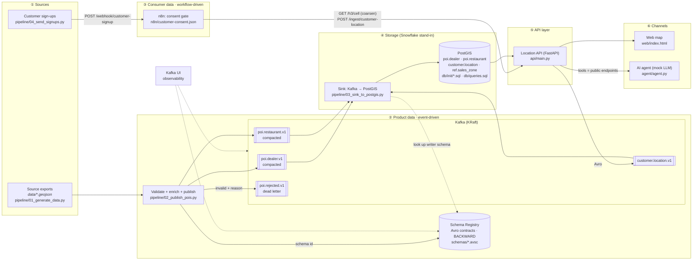
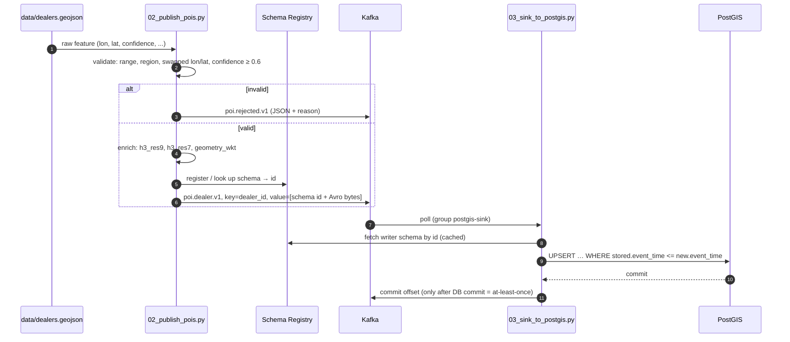
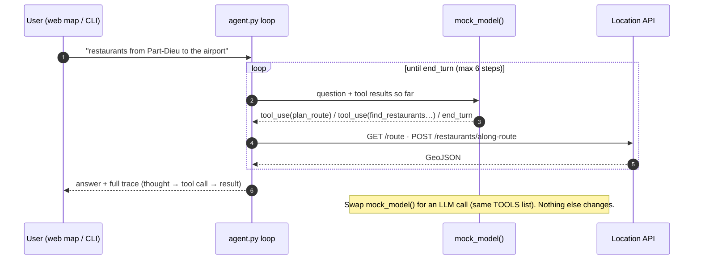

# FleetConnect — Architecture Map

The single map of the system. Every box names the **file** that implements it, so you can
go from diagram → code → running thing in one hop.
For a detailed, step-by-step technical explanation of every box, see [walkthrough.md](walkthrough.md).

## 1. The whole platform on one page



**Read it left to right:** data is *sourced* ① → *checked and contracted* ② → *distributed* on
Kafka → *stored* ④ → *served* through one API ⑤ → *consumed* by channels ⑥.
Consumer data takes the n8n path ③, where the privacy decision happens **before** anything
reaches Kafka.

## 2. Flow A — product data (dealers, restaurants)



## 3. Flow B — customer sign-up with consent (privacy by design)

```mermaid
sequenceDiagram
  autonumber
  participant C as 04_send_signups.py
  participant N as n8n workflow
  participant A as Location API
  participant K as Kafka
  participant DB as PostGIS
  C->>N: POST /webhook/customer-signup {lon, lat, consent}
  alt consent = true
    N->>A: POST /ingest/customer-location {lon, lat}
  else consent = false
    N->>A: GET /h3/cell?lon&lat&res=7
    A-->>N: {cell: 871f…}
    N->>A: POST /ingest/customer-location {h3_res7 only}
  end
  A->>A: re-check (no coords without consent → 422)
  A->>K: customer.location.v1 (Avro)
  K->>DB: via sink; CHECK constraint refuses a point without consent
  Note over N,DB: privacy enforced 3 times: workflow, API, database
```

## 4. Flow C — AI agent (tool use, mocked model)



## 5. Address book

Containers talk to each other by **service name**. Your laptop uses **host ports**.

| Service         | Inside Docker                 | From your laptop                    | Code / config                 |
|-----------------|-------------------------------|-------------------------------------|-------------------------------|
| Kafka           | `kafka:9092`                  | `localhost:9094`                    | `docker-compose.yml`          |
| Schema Registry | `http://schema-registry:8081` | http://localhost:8085/subjects      | `schemas/*.avsc`              |
| Kafka UI        | —                             | http://localhost:8080               | —                             |
| PostGIS         | `postgis:5432`                | `localhost:5433` (`fleetconnect` / `fleetconnect`) | `db/`          |
| n8n             | `http://n8n:5678`             | http://localhost:5678               | `n8n/customer-consent.json`   |
| API + web map   | `http://api:8000`             | http://localhost:8000 · `/docs`     | `api/main.py`, `web/`         |
| Sink            | —                             | `docker compose logs -f sink`       | `pipeline/03_sink_to_postgis.py` |

## 6. Contracts and stores

| Kind  | Name                   | Key           | Notes                                                    |
|-------|------------------------|---------------|----------------------------------------------------------|
| Topic | `poi.dealer.v1`        | dealer_id     | Avro, compacted (latest state per dealer)                |
| Topic | `poi.restaurant.v1`    | restaurant_id | Avro, compacted                                          |
| Topic | `customer.location.v1` | customer_id   | Avro, 7-day retention, point only with consent           |
| Topic | `poi.rejected.v1`      | source id     | JSON dead letter: `{source_topic, reason, record}`       |
| Table | `poi.dealer`           | dealer_id     | `geometry(Point,4326)` + GiST, H3 columns, GIN on sizes  |
| Table | `poi.restaurant`       | restaurant_id | same pattern                                             |
| Table | `customer.location`    | customer_id   | geom nullable; CHECK: no point without consent           |
| Table | `ref.sales_zone`       | zone_id       | polygons for point-in-polygon                            |

## 7. API endpoints (who calls what)

| Endpoint                         | Called by               | Reads / writes          |
|----------------------------------|-------------------------|-------------------------|
| `GET /layers/dealers`, `/layers/restaurants` | web map     | PostGIS                 |
| `GET /dealers/nearest`           | web map, agent          | PostGIS (KNN + re-sort) |
| `GET /route`                     | web map, agent          | mock routing            |
| `POST /restaurants/along-route`  | web map, agent          | PostGIS (ST_DWithin)    |
| `GET /h3/cell`                   | web map, n8n            | h3 library              |
| `GET /analytics/demand-h3`       | web map                 | PostGIS, k-anonymised   |
| `POST /ingest/customer-location` | n8n                     | Kafka (Avro)            |
| `POST /agent/ask`                | web map                 | agent → the endpoints above |
| `GET /places`                    | web map, agent          | gazetteer (mock geocoder) |

### Demo control panel (`api/control.py`, "Produce & test" tab)

Not part of the Location API contract; it exists so you can drive the pipeline from the browser.
Every action reuses the real pipeline code.

| Endpoint                     | What it does                                                           |
|------------------------------|------------------------------------------------------------------------|
| `POST /control/run/{step}`   | Runs `pipeline/01…04` scripts (`generate`, `publish`, `schema-test`, `signups`) and returns their output |
| `POST /control/dealer`       | One dealer from a map click → same validation, H3, Avro path → `poi.dealer.v1` or `poi.rejected.v1` |
| `POST /control/signup`       | One sign-up from a map click → n8n webhook → consent workflow           |
| `GET /control/status`        | Messages per topic, sink consumer lag, PostGIS row counts, schema versions |
| `GET /control/messages`      | Newest messages on a topic: partition, offset, key, schema id, decoded value |

## 8. Local stand-in → enterprise equivalent

| Here (local)                  | In an enterprise CX platform                                  |
|-------------------------------|---------------------------------------------------------------|
| Single Kafka broker, RF=1     | Managed Kafka / Confluent Cloud / MSK, RF=3, min.insync=2, multi-AZ |
| Schema Registry, BACKWARD     | Same, plus schema checks in CI before merge                   |
| Kafka UI                      | Lag / throughput / error dashboards + alerting                |
| Python sink                   | Kafka Connect sink or Snowpipe Streaming into Snowflake       |
| PostGIS                       | Snowflake `GEOGRAPHY`, `ST_*`, `H3_*` functions; raw → curated layers |
| n8n (single container)        | n8n queue mode with workers, git-versioned workflows, secrets vault |
| FastAPI, no auth              | API gateway, OAuth2 scopes, rate limits                       |
| `mock_model()`                | LLM with tool use; same tools, same guardrails                |
| Straight-line `/route`        | OSRM / Valhalla / commercial routing API                      |
| Gazetteer `/places`           | Geocoding service (returns match level + confidence)          |

## 9. Role responsibility → where it shows

| From the role brief                         | Show this                                                         |
|---------------------------------------------|-------------------------------------------------------------------|
| Event-driven product data on Kafka          | Flow A; Kafka UI topics, compaction, keys                         |
| Schema governance with Avro                 | `schemas/`, `02b_schema_evolution_demo.py` (409 on breaking change) |
| Data quality                                | validation rules in `pipeline/common.py`, `poi.rejected.v1`       |
| Observability                               | Kafka UI → consumer group `postgis-sink` lag                      |
| Consumer data with n8n                      | Flow B; open the workflow in n8n                                  |
| Snowflake patterns                          | `db/queries.sql` (each query lists its Snowflake equivalent)      |
| Privacy by design                           | consent gate ×3, H3 coarsening, k-anonymity threshold             |
| API-led architecture                        | Section 7: every channel uses the API, nothing else               |
| AI agents / agentic AI                      | Flow C; tool boundaries, trace, step limit, grounding             |
| Standards & reference architecture          | `pipeline/common.py` (one place for CRS, H3, topics, thresholds)  |
